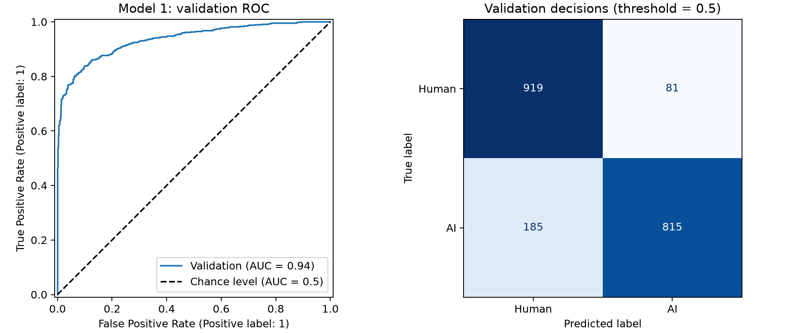

# Cornell Tech CS5785 — Model 1 Baseline

**Word TF-IDF + Logistic Regression** for Human vs AI text classification.

This repository contains the verified, untuned Model 1 handoff for team comparison.
Label **0 = Human**, **1 = AI**. This is a local validation result, not a Kaggle score.

## Results

| Partition | Examples | AUROC | Accuracy at 0.5 | AI F1 at 0.5 |
|---|---:|---:|---:|---:|
| Training | 8,000 | 0.993194 | 95.175% | 0.950103 |
| Validation | 2,000 | **0.936066** | **86.70%** | 0.859705 |

On validation: 919 Human texts correctly classified, 81 Human texts classified as AI;
815 AI texts correctly classified, 185 AI texts classified as Human.
Original fit time: about 2.15 seconds on the recorded machine, including TF-IDF.



## Start here

- [Metrics](results/model1_baseline_v1/metrics.csv)
- Validation predictions are restored locally with `src/prepare_data.py`; join models by `id`.
- [Training code](src/train_baseline.py)
- [Saved model](models/model1_baseline_v1.joblib)
- [Full experiment settings](results/model1_baseline_v1/metrics.json)

## Reproduce or verify

Use Python 3.12 (original runtime: 3.12.6). Download `train.csv` from the [official competition Data page](https://www.kaggle.com/competitions/cornell-tech-cs-5785-combined-2026-ai-vs-human-text/data) and place it in `data/raw/train.csv` (create the folders as needed). This repository does not redistribute competition articles or row-level labels/predictions.

From the repository directory:

```bash
python3.12 -m venv .venv
.venv/bin/python -m pip install -r requirements.lock.txt
.venv/bin/python src/verify_package.py
.venv/bin/python src/prepare_data.py
.venv/bin/python src/verify_model1.py
```

The package check verifies uploaded files. `prepare_data.py` checks the official input, restores the exact ordered split and reference predictions locally, and compares all six generated CSVs with their original SHA-256 hashes. It does not retrain. `verify_model1.py` then loads the model, checks predictions and independently recomputes AUROC.

On Windows, create the environment with `py -3.12 -m venv .venv` and use `.venv\Scripts\python.exe` instead of `.venv/bin/python`. Other operating systems and fresh dependency installations have not been tested. Exact CSV hash checks may fail with different library/platform numerical behavior; retain the error for inspection.
To retrain the same configuration in a new directory without replacing the baseline:

```bash
.venv/bin/python src/reproduce_baseline.py
```

Do not run the training script over the saved baseline: it intentionally stops
when reference model/results exist. The reproduction script handles a separate run.

## Predict new articles

After installing the dependencies, run Python from the repository directory:

```python
import joblib
model = joblib.load("models/model1_baseline_v1.joblib")
articles = ["Replace this with the full English article."]
p_ai = model.predict_proba(articles)[:, 1]
print(p_ai)
```

The saved Pipeline performs both TF-IDF transformation and classification.
No retraining is needed. Scores >= 0.5 are classified as AI in this baseline.
Only load trusted model files; probability calibration has not been evaluated.

## Fixed split and model

- Official `train.csv`, original input row order.
- scikit-learn `train_test_split(test_size=0.2, random_state=42, stratify=y)`.
- Training: 4,000 Human + 4,000 AI. Validation: 1,000 Human + 1,000 AI.
- Split version: `sklearn_stratified_seed42_v2`. Use the saved ID files to align models.
- Word ngrams `(1,2)`, `min_df=2`, `max_features=50000`, sublinear TF, L2 normalization.
- Logistic Regression: L2 regularization, `C=1`, `lbfgs`, `max_iter=1000`.
- Vocabulary, IDF and classifier fitted only on the 8,000 training examples.
- Teammate split prompt is matched; their actual saved IDs have not been independently checked.

## Data and scope

Data source: [official Kaggle competition](https://www.kaggle.com/competitions/cornell-tech-cs-5785-combined-2026-ai-vs-human-text/data).
The public repository contains code, the fitted model, aggregate metrics and the split specification. Original articles, per-row labels, split CSVs and prediction tables are excluded; authorized participants obtain official data from Kaggle and restore the local files as described above.

`REFERENCE_MANIFEST.json` records the original local handoff checksums; some listed files are intentionally not distributed here. `MANIFEST.json` checks only the files included in this repository.

Personal notes, account information, environment folders and old archives are excluded.

No tuning, learning-curve experiment, pseudo-labeling experiment, test prediction
or Kaggle submission is claimed. Generalization outside this holdout is unverified.
The training AUROC exceeds validation AUROC; this generalization gap remains a limitation.

AI assisted code development and debugging. The baseline and handoff were actually
run and checked. Refer to the course requirements for final report/PR obligations;
this repository is a Model 1 handoff, not the entire group-project submission.
